# 智能客服 Agent（AgentCustomService）

基于 **FastAPI + LangChain + Vue3 + Element Plus** 全自建的电商智能客服系统，
架构参考作者的另一个项目 `AgentChat`（仅参考设计思路，代码全新重建）。

## 核心能力（P0–P8 已全部落地）

| 能力 | 阶段 | 说明 |
|---|---|---|
| 流式多轮对话 | P0 | SSE 流式输出、会话管理、JWT 登录 |
| RAG 商品知识库 | P1 | Excel/PDF/图片/TXT 上传解析；向量+BM25 混合检索（RRF 融合 + rerank）；引用溯源；Excel 同步写结构化商品表，价格/库存走 SQL 精确查询 |
| 三级记忆 | P2 | 短期 token 滑窗 / 中期会话滚动摘要 / 长期用户画像（向量召回，管理页可删） |
| 企业微信转人工 | P3 | 关键词/模型判定先**询问买家**、回复确认后才建单（P8 两步制，见下）；自建应用 textcard 推送客服，回调回复回写会话；状态机 bot↔awaiting_confirm↔pending_human↔human；未配企微时 mock 外发箱演示 |
| MCP | P4 | stdio/sse/streamable_http 服务器接入，工具自动发现并 bind；写操作确认卡片（180s 超时默认拒绝） |
| 管理控制台 | P5 | 知识库/商品/检索测试、转人工工作台、记忆管理、MCP 管理、设置；聊天内工具过程、引用、人工客服徽标展示 |
| 电商平台接入 | P7 | 淘宝/京东/拼多多/抖店 webhook 回调 + 自动回复；影子用户/会话映射复用同一 Agent 管道；客服工作台回复自动送达平台买家；mock 模式无资质可演示全链路（真实参数见 docs/平台接入.md） |
| 会话运营台 | P8 | /chat 变为「客（买家）↔我（Agent）」全渠道视图；转人工两步制（Agent 询问→客户确认才建单转企微）；5 分钟空闲提示结束、再 1 分钟无回复自动终结会话并强制关闭未结工单；运营可代答（买家无感人工/AI），支持粘贴截图/发送文件 |
| 生产化：安全 | B3 | 附件链接改为 HMAC 签名 URL（旧的裸静态挂载已废）；MCP 除命令名白名单外还拒绝解释器内联代码（`python -c`/`node -e`）、越界脚本路径与生产下的 `npx/uvx`；CORS 进配置；密钥支持 `${ENV}` 注入；`server.env=production` 打开硬闸（默认密钥、回调不验签、CORS 通配、内网 MCP 端点、自助注册）——致命项直接拒绝启动 |
| 生产化：角色与权限 | B3 | admin / staff（客服）/ user 三档；跨用户会话只读、代答、工单、MCP 确认卡片只对 staff+ 开放，普通用户自动退化为"只看自己"；生产默认关闭自助注册，由 admin 建号 |
| 生产化：可观测与计量 | B3 | 每次模型外呼落 `llmcall` 流水（token/耗时/成本估算/成功失败），四类能力分开探测；`GET /api/v1/system/usage`、`GET /api/v1/system/alerts`、Prometheus 文本端点 `/metrics`；`/health` 存活 + `/ready` 就绪分离；写路径与外部回调走令牌桶限流 |
| 满意度回访 | B3 | 结单时可附一条带 HMAC 签名的评价链接（免登录、默认 7 天有效、一会话只记第一票）；回访页是无 JS 的纯表单，平台内置浏览器也能打开；看板汇总均分/参评率/1-5 分布。开关 `session.rate_survey_enabled`，默认关 |
| 生产化：多副本与交付 | B3 | MCP 确认表与记忆管道任务落库，生命周期扫描/记忆补跑/出站重试走 `workerlease` 租约选主，可以多进程多副本；Alembic 迁移体系（`database.migrate_mode`）；备份支持 SQLite/MySQL/PostgreSQL 并带 manifest，新增恢复演练与向量对账脚本；CI 一键跑「离线单测 + 静态检查 + 端到端冒烟 + 前端测试 + Docker 构建」 |

## 快速开始

### 一键演示（30 秒看到满数据的六个界面）

```bash
cd src/frontend && volta run npm run build      # 只需一次：产出 dist 给后端同源托管
cd ../backend
py scripts/seed_demo_data.py --serve           # 灌演示数据 + 起服务，打开 http://127.0.0.1:7866
```

一条命令做完三件事：在 `src/backend/data/demo/` 里**自造一份隔离配置**（不碰开发者本机的
`data/cs_agent.db`，该目录已 gitignore）→ 建表并灌入一份像样的一线运营数据 → 同源托管前端 dist。
**不需要模型 api_key**：没有 embedding key 时语料照灌，检索降级 BM25，界面数据不受影响。

演示账号（密码统一 `Demo@2026`）：

| 账号 | 角色 | 能看到的 |
|---|---|---|
| `demo_admin` | 管理员 | 六个界面全开，含运营看板与 MCP 配置 |
| `demo_staff_wang` | 客服 | 工作台/工单/代答，看不到 MCP 服务器配置入口 |
| `demo_buyer_chen` | 普通成员 | 只看自己的会话与画像（角色门禁的活样本） |

常用变体：

```bash
py scripts/seed_demo_data.py --serve --reset        # 清空演示库重来（判定为演示库才允许清）
py scripts/seed_demo_data.py --serve --port 7870    # 换端口
py scripts/seed_demo_data.py --rearm                # 截图前重新下发 MCP 确认卡片（TTL 180 秒）
py scripts/seed_demo_data.py                        # 只灌当前 CS_CONFIG 指向的库，不起服务
```

脚本在 `server.env=production` 下直接拒绝执行，且默认只往"空库或纯演示库"写
（`--force-any-db` 才能强行灌进真实库）——`--reset` 是清全表，所以这两道保护是刻意的。

### 界面一览

| 登录（三角色入口） | 会话运营台：客↔我全渠道视图、工具痕迹、引用溯源 |
|---|---|
| 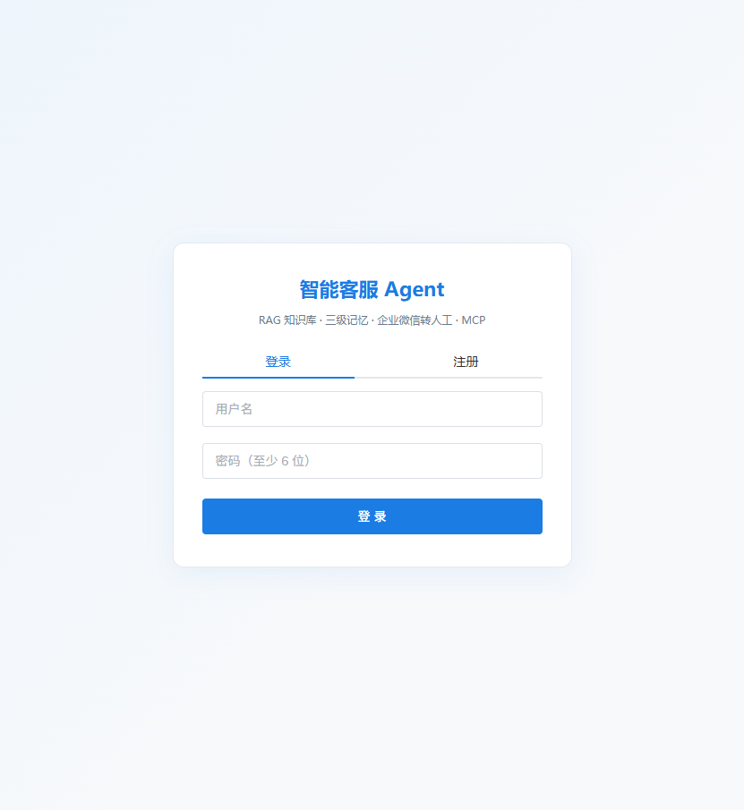 | 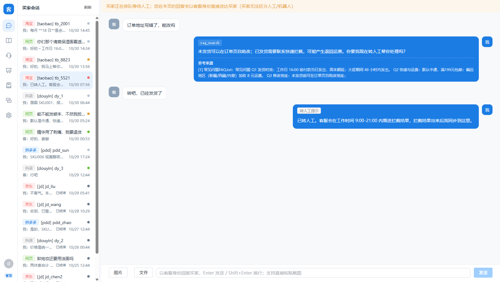 |
| **买家视角**：普通成员只看自己的会话，Agent 回复带商品与检索工具徽标 | **知识库 · 文档管理**：切片数/状态/启用开关，下方是重建任务队列（含"已中断"样本） |
| 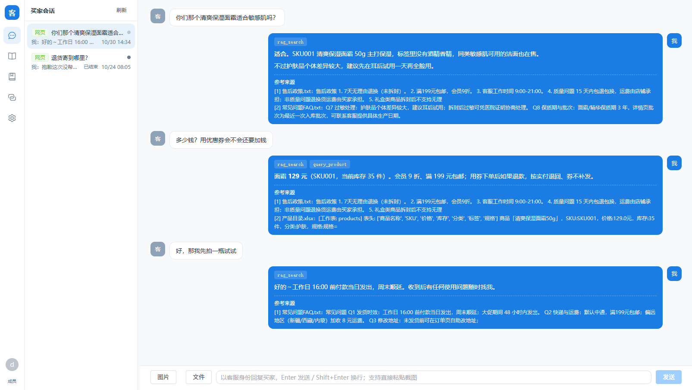 | 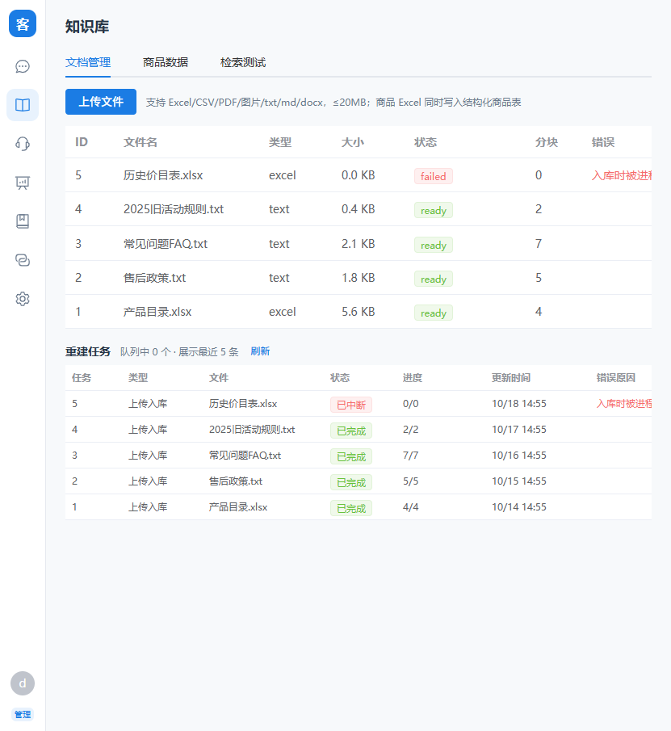 |
| **知识库 · 检索测试**：向量+BM25 混合召回（无 key 时纯 BM25），带命中分块与来源 | **转人工工作台**：工单状态机、首响与处理时长、右侧人工回复面板 |
| 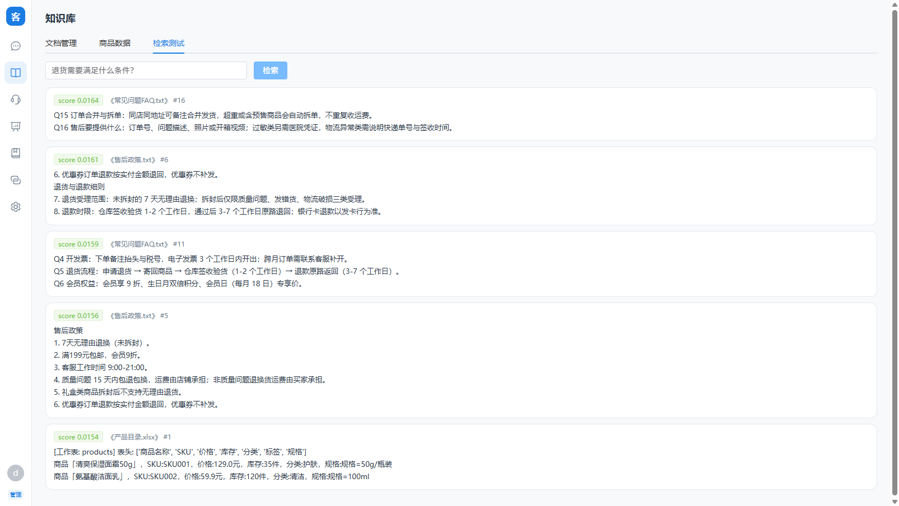 | 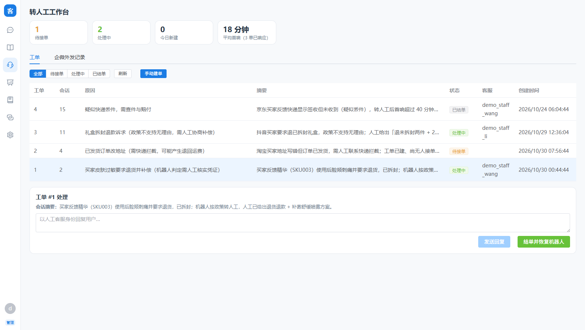 |
| **转人工 · 外发记录**：企微 textcard 落外发箱，四种渠道来源一眼可辨 | **运营看板**：解决率/转人工率/轮次/关闭率 + 人工侧效率、会话时长、满意度分布、模型用量与成本 |
| 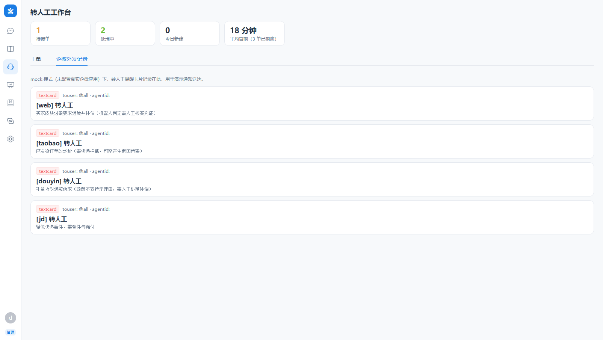 | 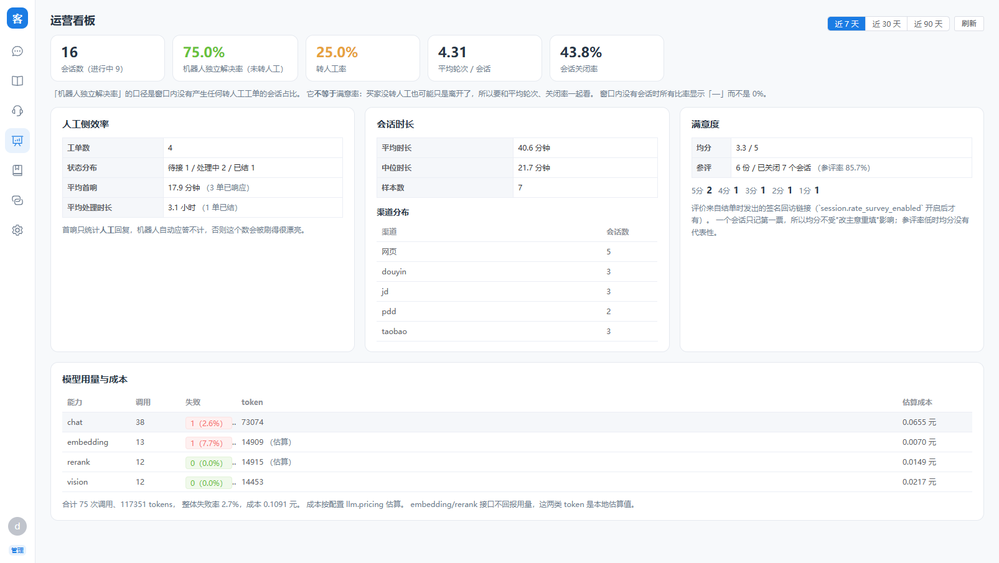 |
| **记忆 · 长期画像**：对话结束后抽取的稳定事实（偏好/身份/工单结论），可删并同步清向量 | **记忆 · 中期摘要**：短期滑窗之外的历史被滚动压缩成摘要注入系统提示 |
| 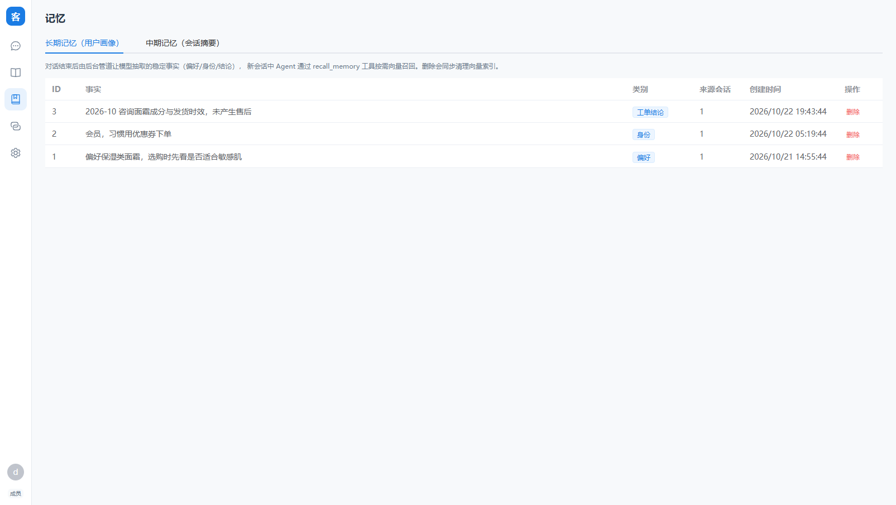 | 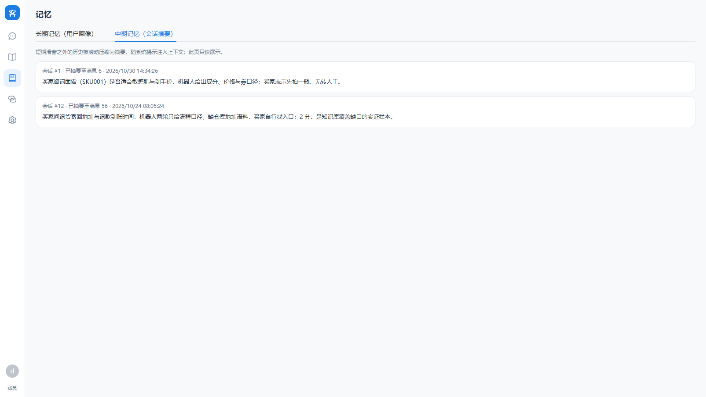 |
| **MCP**：待确认的工具调用卡片（参数原文 + 同意/拒绝，180 秒超时按拒绝）与服务器列表 | **设置**：成员与角色、服务状态、运行告警、模型用量成本、平台就绪自检 |
| 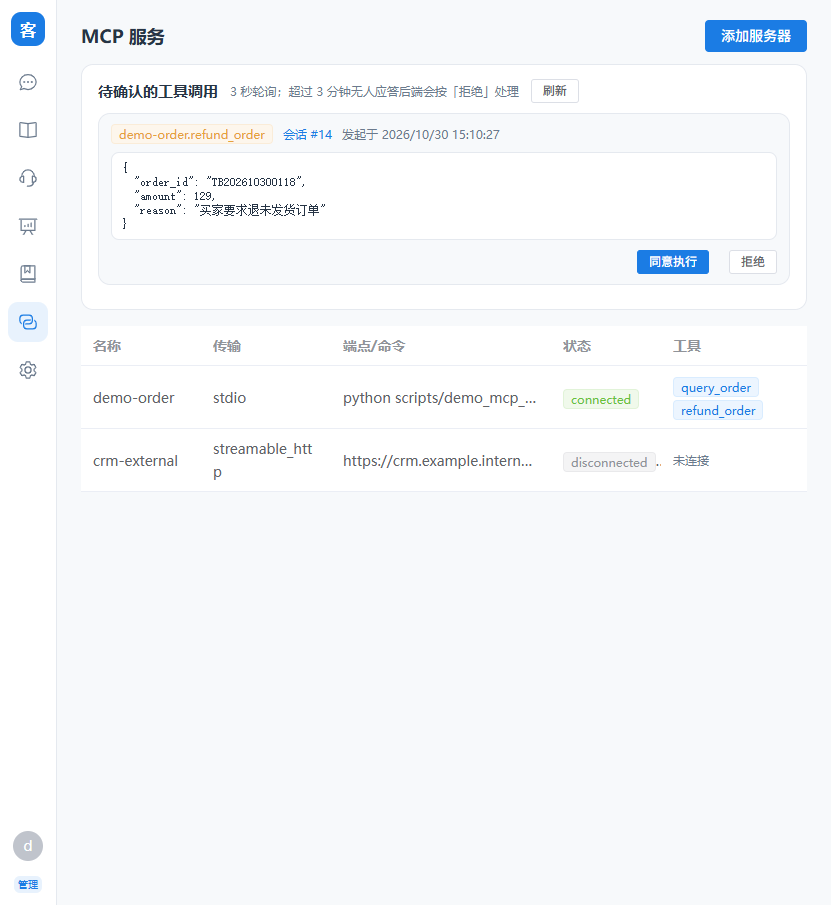 | 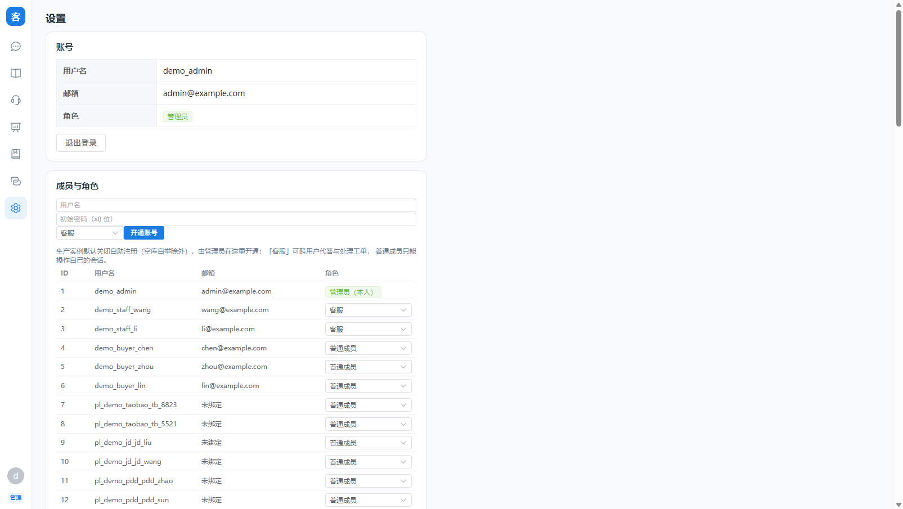 |

### 后端（端口 7861）

```bash
cd src/backend
py -m pip install -r requirements-dev.txt -i https://pypi.tuna.tsinghua.edu.cn/simple
# 创建本地覆盖配置（含真实 api_key），勿提交：
#   复制 config.simple.yaml -> config.local.yaml，填写 multi_models.dashscope.api_key
#   然后 export CS_CONFIG=config.local.yaml
py run.py                    # host/port/workers 读配置里的 server.*
```

- 健康检查 `GET /health`（存活），就绪检查 `GET /ready`（库可查 + 迁移已跑 + 无致命安全项），
  接口文档 `GET /docs`，指标 `GET /metrics`（配 `security.metrics_token` 后用 `?token=`）
- **不想写配置文件也能跑容器**：`CS_JWT_SECRET` / `CS_MODEL_API_KEY` / `CS_SERVER_PORT` /
  `CS_PUBLIC_BASE_URL` / `CS_CORS_ORIGINS` / `CS_SERVE_FRONTEND` 等环境变量可直接覆盖对应配置项
  （完整表见 `app/config.py` 的 `ENV_OVERRIDES` 与 docs/运维手册.md 第 2 节）；
  YAML 里任何字符串值还能写 `${VAR}` / `${VAR:-默认}` 引用环境变量
- **可以多进程部署了**（B3-8）：确认表与记忆任务已落库，后台扫描/补跑/出站重试靠
  `workerlease` 租约选主。BM25 缓存、MCP 工具缓存与限流桶仍是每进程一份，
  所以 `rate_limit` 的阈值要按副本数折算；SQLite 建议保持单 worker，多副本请换 Postgres
- 数据库默认 SQLite：`src/backend/data/cs_agent.db`（自动创建，相对路径锚定到后端根目录，
  换 cwd 启动不会漂移）
- **模型 key 需要哪些能力**：`chat`（对话/摘要/画像）、`embedding`（向量化）、`rerank`（重排）、
  `vl`（图片知识库）是四类独立权限。订阅套餐类 key（如 token-plan）常只放行对话模型，
  此时向量化会 404/403，检索自动降级 BM25——不是代码问题，需换放行 embedding 的标准 key。
- **未配置有效 api_key 时的降级行为**：对话报可读错误；上传自动跳过向量化，检索降级
  BM25 关键词；图片解析不可用；转人工/工单回路不受影响（不依赖模型）。

### 前端（端口 8091）

```bash
cd src/frontend
npm install        # 本机建议 volta run npm install
npm run dev
```

浏览器打开 <http://localhost:8091>，注册任意测试账号。`/api` 由 Vite 代理到 7861。
页面：会话运营台（/chat，P8 起为「客=买家 ↔ 我=Agent」全渠道视图）、知识库（/knowledge）、
转人工工作台（/handoff）、记忆（/memory）、MCP（/mcp）、设置（/settings）。

### 质量闸门

```bash
# 离线（不需要后端在跑、不打模型）
py -m pytest                        # 380 项单测：临时 SQLite + 临时 Chroma，模型 key 留空走降级路径
py -m ruff check src eval           # 120 列，规则 E,F,W,I,B,UP,C4,SIM；刻意不跑 ruff format
py -m mypy                          # 覆盖 app/ 与 eval/，口径 0 error
cd src/frontend && volta run npm run typecheck
cd src/frontend && volta run npm run test        # vitest + jsdom（72 项，含 XSS 与角色门禁回归）

# 端到端（自动在临时端口拉起隔离实例，跑完自动关掉；不碰本机 data/）
cd src/backend && py scripts/ci_smoke.py
cd src/backend && py scripts/ci_smoke.py --serve-only --keep-running --port 7861   # 只起服务，手工在浏览器验证
```

`scripts/ci_smoke.py` 是让端到端进 CI 的关键：以前三套冒烟脚本要求"后端已经在 7861 上跑着"，
所以从没进过流水线，SSE 协议、回调路由、附件鉴权这些只在真 HTTP 栈上暴露的问题就没人拦。
它用临时 SQLite/Chroma + 随机 jwt_secret 起服务，无模型 key 时向量化类断言打印 SKIP（预期降级）
而不是假失败；注入 `CS_MODEL_API_KEY` 后评测的对话断言会真跑。

GitHub Actions 已经把这四道离线闸门 + 冒烟 + 前端 + Docker 构建串好，
见 [.github/workflows/ci.yml](.github/workflows/ci.yml)。

配置都在仓库根 `pyproject.toml`（pytest 的 `testpaths` 限定了收集范围，去掉会把
`scripts/smoke_test.py` 当测试文件导入并在模块末尾 `sys.exit()` 上直接 INTERNALERROR）。

### 演示数据与验证

```bash
cd src/backend
py scripts/ci_smoke.py                    # 一条命令跑下面三套端到端（自动起隔离服务）
#   等价于分别执行（需要后端已在 7861 上跑着）：
#   py scripts/smoke_test.py       45 项端到端（P1 入库/分块可视/重新入库/重建向量、P3 转人工闭环、P4 MCP 发现）
#   py scripts/platform_smoke.py   29 项平台+生命周期（P7 回调映射/幂等去重 / P8 确认式转人工、代答外发、
#                                  超时终结后重新开一轮 / 运营台手动建单+看板统计）
#   py ../../eval/run_eval.py       9 项评测（检索召回/商品精确查询/对话质量断言）
CS_CONFIG=config.local.yaml py scripts/reindex_vectors.py     # 换 embedding 模型或补建向量（以 Chunk 表为准）
CS_CONFIG=config.local.yaml py scripts/reingest_files.py --all  # 改了 parser/chunker 后重建切片+向量+商品
CS_CONFIG=config.local.yaml py scripts/verify_restore.py      # Chunk 表 ↔ Chroma 向量对账（--fix 补建缺口）
```

单文件重建不用停服务手跑脚本：知识库页每行有「分块」（看切片正文与是否已建向量）、
「重新入库」（重跑解析+分块+向量化，failed 文件与 parser 改动后修复都走它）与
「重建向量」（只补向量，换 embedding 模型后用）三个按钮，任务是后台跑的，页面自动轮询状态。

演示物料：`py scripts/seed_demo_data.py --serve` 一条命令即可（见上文「一键演示」）；
它内部用的源文件是 `data/demo_products.xlsx`（4 个 SKU）、`data/demo_policy.txt`（售后政策）、
`scripts/demo_mcp_server.py`（FastMCP 订单查询服务器，MCP 页可按其命令添加 `demo-order`）。
平台买家演示（无需资质）：`POST /api/platform/taobao/callback` 发 `{"buyer_id":"b1","shop_id":"s1","text":"…","msg_id":"m1"}`
→ 运营台自动出现「[taobao] b1」会话并展示 Agent 自动回复历史。
转人工演示（P8 两步制）：买家消息含"转人工/投诉"→ Agent 先询问是否转人工 → 买家回复"是"→
建单推企微 → 运营台/工作台人工回复（买家无感人工/AI，平台会话经外发箱送达）→ 结单恢复机器人；
会话空闲 5 分钟自动发结束提示，再 1 分钟无回复自动终结并强制关闭未结工单。

## 文档索引

- [项目结构说明](docs/项目结构说明.md) — 目录职责、模块导览与分层依赖规则
- [代码规范](docs/代码规范.md) — 后端/前端编码约定
- [工具规划](docs/工具规划.md) — Agent 工具清单、判断结论与实施现状
- [平台接入](docs/平台接入.md) — 四平台 webhook/签名/API 参数字典与真实对接 checklist（P7）
- [运维手册](docs/运维手册.md) — **交付与值守必读**：部署形态、密钥注入、生产硬闸、上线 checklist、备份恢复演练、迁移、回滚、容量阈值
- [待办与风险](docs/待办与风险.md) — 部署约束、安全暴露面、未完成项、测试缺口与建议路线
- [评测用例](eval/cases.yaml) — 检索/商品/对话质量断言

## 配置体系

统一 YAML（非 .env），加载优先级：**环境变量覆盖 > `CS_CONFIG` 指向的文件 > `config.simple.yaml`**。
`config.local.yaml`（真实密钥）已被 .gitignore 排除。任何字符串值可写 `${VAR}` 或
`${VAR:-默认值}` 引用环境变量，密钥不必落文件。顶层节（与 config.simple.yaml 一一对应）：
`server`（host/port/**env**/workers/public_base_url/cors_origins/serve_frontend；
`env: production` 打开安全硬闸并拒绝启动致命项）、`database`（url +
**migrate_mode**: `auto`=create_all+幂等补列，`alembic`=启动跑 `upgrade head` 且不 create_all）、
`security`（jwt_secret/算法/有效期/media_url_secret+TTL/allow_registration/metrics_token/rate_limit）、
`multi_models` + `default_model`（对话/向量/视觉/rerank 四类权限，`capability_ready()` 分开探测）、
`llm`（超时与重试、**fallback** 备用 provider 链、**pricing** 成本估算价目）、
`memory`（短期窗口与长期开关）、`session`（P8 空闲提示/自动终结秒数与扫描周期）、
`rag`（分块与召回参数、Chroma 路径、重建 worker 数、**embedding_batch_size**、
**bm25_persist**/**bm25_index_path**）、`mcp`（allowed_commands、
**allowed_script_roots**、**allow_package_runners**、**allow_private_urls**）、
`agent`（客服 Agent 的人设与话术：名字/语气/回复长度/转人工策略，见下）、
`wecom`（自建应用与回调，`mock: true` 时不外发）、
`platforms`（四电商平台的凭证/网关/回调验签与回复参数字典，同样支持 mock）。
注意 CS_CONFIG 指向的文件是**整文件替换**（不合并默认值），本地覆盖文件需自带全部节。
生产配置样例见 [src/backend/config.production.example.yaml](src/backend/config.production.example.yaml)。

## 备份与部署

```bash
cd src/backend
py scripts/backup_data.py --dry-run          # 看要备哪些、多大
py scripts/backup_data.py --keep 7           # 一致性快照 + chroma/uploads/配置 + manifest，轮转留 7 份
py scripts/restore_data.py --list            # 有哪些快照（含清单摘要）
py scripts/restore_data.py --snapshot <路径> --verify-only   # 只核对清单，不动 data/
py scripts/restore_data.py --snapshot <路径> --yes           # 真恢复（现有数据先挪进 .restore-pre-*）
py scripts/verify_restore.py [--fix]         # 恢复后对账 Chunk 表 ↔ Chroma 向量，缺口可补建
```

- SQLite 用 `sqlite3` backup API 复制（服务开着 WAL 时手抄 `.db` 会漏掉 `-wal` 里的最新写入），
  备完自动跑 `PRAGMA integrity_check`；MySQL 走 `mysqldump --single-transaction`、
  PostgreSQL 走 `pg_dump`，**口令不放命令行**（同机 `ps` 可见），走 0600 defaults 文件
  或只注入子进程的 `PGPASSWORD`。
- 每份快照带 `manifest.json`（库类型、表数/行数、目录文件数、工具版本）；没有清单的备份
  在恢复那天只能现场赌。`restore_data.py` 会把"直接 cp 出来的残缺 WAL 主文件"判死。
- **恢复不删东西**：现有库文件/`chroma/`/`uploads/` 先挪进 `data/.restore-pre-<时间戳>/`；
  配置文件不自动覆盖（快照里的密钥与路径是备份那台机器的）。
- Chroma 是运行中拷出来的，可能撕裂：`Chunk` 表才是唯一真相，恢复后务必
  `verify_restore.py`，缺向量 `--fix`。外部数据库的灌库命令脚本只打印不代做。
- 没演练过恢复的备份不算备份。上线 checklist 第 6 步就是做一次完整演练
  （docs/运维手册.md 第 6 节）。

容器化：`Dockerfile` 是两阶段构建（node 打前端 dist → python 运行期），
**单容器同源交付**：`CS_SERVE_FRONTEND=true` 时后端直接托管前端，免 nginx、免 CORS。
`docker-compose.yml` 里生产硬闸、JWT 密钥、模型 key、公网地址都走环境变量（缺密钥时
compose 直接拒绝起容器，而不是起来后裸奔）。想分副本部署就把 `serve_frontend` 关掉。
镜像构建、容器健康检查与端到端冒烟已在 CI 的 `docker` job 里真跑（本机没有 docker，
所以验证由流水线承担）。多副本与 Postgres 形态见 docs/运维手册.md 第 1、7、8 节。

**多个店同时上线**用 [`deploy/`](deploy/README.md) 那一套，不是根目录这份单店 compose：
一店一个容器 + 一店一个库 + 一店一套向量目录 + 一店一个域名，共享的只有镜像和反代。
里面是一店一份的配置模板（`shop.example.yaml` + `env.shop.example`）、多店
`docker-compose.shop.yml`、带 SSE 关缓冲配置的 `nginx.shop.conf`、裸机用的
`cs-agent@.service` 与每店快照 `cs-backup@.timer`。为什么必须是多套实例（三条代码依据）
写在 docs/运维手册.md 第 1.1 节。

## 已知边界与取舍

- BM25 索引可持久化（`rag.bm25_persist`，默认开），语料涨到十万级仍建议换专职检索引擎；
  实测数据见 `py scripts/bench_rag.py` 与 docs/运维手册.md 第 8 节。
- SQLite 单写者：三方并发（请求/sweeper/入库 worker）靠 WAL + `busy_timeout` 扛，
  高并发下写入排队可见。要多副本就换 Postgres/MySQL（租约与队列已经为此准备好了）。
- 限流、HTTP 计数、MCP 工具缓存是**每进程**的：多副本时阈值按副本数折算，
  指标由抓取端聚合。
- RBAC 是 admin/staff/user 三档 + 会话归属过滤，**没有多租户**：知识库、商品表、MCP
  配置仍是全局共享，一个实例服务多个互不信任的商家需要额外隔离（目前靠部署多套，
  形状与依据见 [`deploy/README.md`](deploy/README.md) 与 docs/运维手册.md 第 1.1 节）。
- 电商四平台的真实出站参数未核对官方文档，默认 mock；平台名下的可配置骨架、
  `needs_review` 标记与就绪自检见 `docs/平台接入.md` 与 `GET /api/v1/platforms/readiness`。
- 企微真实回调报文未与服务器对过（签名/加解密口径自洽，不是联调结论）。
- 运营台仍靠轮询取增量（无 SSE/WS 消费方），在线会话数上去后要换长连接。
- 完整清单（含安全暴露面、未验证项、后续路线）见 [待办与风险](docs/待办与风险.md)。

## 致谢与参考

架构与交互风格参考同栈的 `AgentChat`（Vue3 + FastAPI + LangChain）项目，
本项目为独立重建实现，不包含其源代码。
